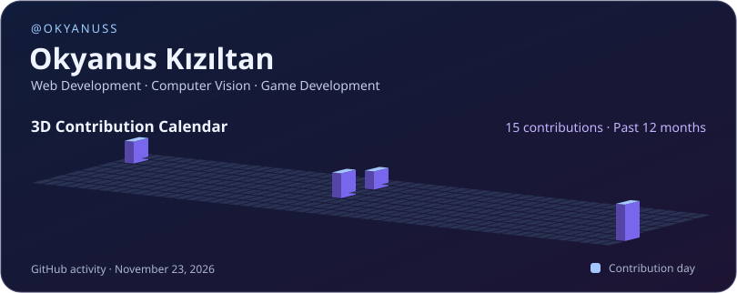

<table><tr>
<td width="45%" valign="top">
<h3>İletişim</h3>

<a href="https://www.linkedin.com/in/okyanus-k%C4%B1z%C4%B1ltan-75b86037a/">LinkedIn</a> · <a href="mailto:okyanus.kiziltan@outlook.com">E-posta</a>

<h3>GitHub</h3>

<a href="https://github.com/OkyanusS?tab=repositories">Tüm depolar</a> · <a href="https://github.com/OkyanusS#js-contribution-activity-description">Katkı geçmişi</a>

</td>
<td width="55%" valign="top">
<h3>Teknolojiler</h3>

<h3>Proje kataloğu</h3>
<ul>
<li><a href="https://github.com/OkyanusS/OpenCV-MediaPipe">Computer Vision with OpenCV &amp; MediaPipe</a> · Bilgisayarlı görü çalışmaları</li>
<li><a href="https://github.com/OkyanusS/Unity-Project">SpaceFight</a> · Unity ile oyun geliştirme</li>
<li><a href="https://github.com/OkyanusS/Web-Programming">Web Programming Exercises</a> · Web programlama alıştırmaları</li>
<li><a href="https://github.com/OkyanusS/web-development-fundamentals">Web Development Fundamentals</a> · HTML ve PHP alıştırmaları</li>
<li><a href="https://github.com/OkyanusS/webproject">Web Design Project</a> · Web arayüzü çalışması</li>
</ul>
</td>
</tr></table>
