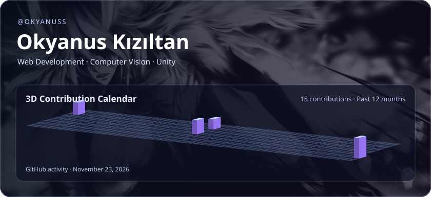

<table><tr>
<td width="34%" valign="top">
<h3>Contact</h3>

<a href="https://www.linkedin.com/in/okyanus-k%C4%B1z%C4%B1ltan-75b86037a/"><strong>LinkedIn</strong></a> · <a href="mailto:okyanus.kiziltan@outlook.com"><strong>Email</strong></a>

<h3>Tech Stack</h3>

HTML, CSS, JavaScript, PHP C#, Unity, OpenCV, MediaPipe

<a href="https://github.com/OkyanusS?tab=repositories">Browse all repositories →</a>

</td>
<td width="66%" valign="top">
<h3>Featured Projects</h3>

<a href="https://github.com/OkyanusS/OpenCV-MediaPipe"><strong>Computer Vision Lab</strong></a> Computer vision experiments with OpenCV and MediaPipe.

<a href="https://github.com/OkyanusS/Unity-Project"><strong>SpaceFight</strong></a> A Unity game project written in C#.

<a href="https://github.com/OkyanusS/webproject"><strong>Web Design Project</strong></a> A web interface project.

<a href="https://github.com/OkyanusS/Web-Programming">Web Programming Exercises</a> · <a href="https://github.com/OkyanusS/web-development-fundamentals">Web Development Fundamentals</a>

</td>
</tr></table>
